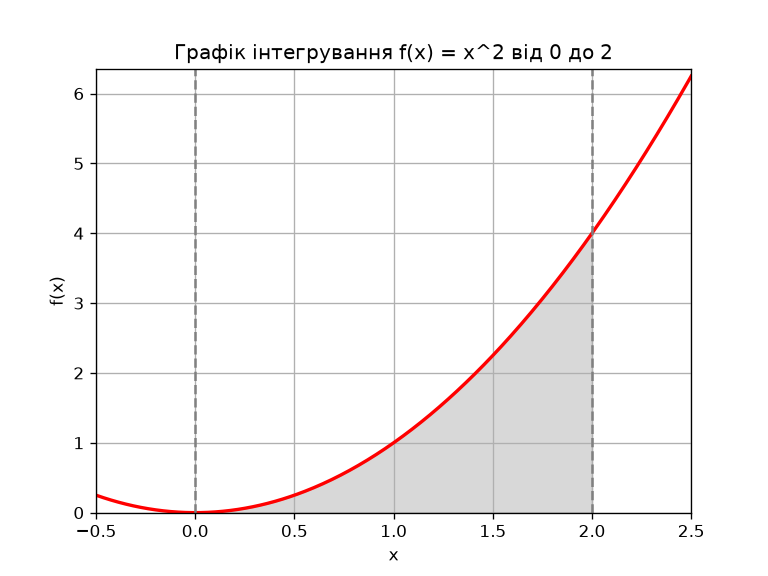

# goit-algo-hw-10 — Домашнє завдання з алгоритмів

## Структура

| Файл | Призначення |
|---|---|
| `task1_coins.py` | Завдання 1: `find_coins_greedy` (жадібний) і `find_min_coins` (динамічне програмування) |
| `test_task1_coins.py` | Юніт-тести для завдання 1 |
| `task2_monte_carlo.py` | Завдання 2: інтеграл `f(x) = x²` на `[0, 2]` методом Монте-Карло |
| `task2_plot.png` | Графік з умови завдання 2 (створює `task2_monte_carlo.py`) |
| `requirements.txt` | Версії numpy, scipy, matplotlib для завдання 2 |
| `readme.md` | Цей файл: висновки до обох завдань |

### Запуск

Завдання 1 використовує лише стандартну бібліотеку Python 3.

```bash
python3 task1_coins.py          # приклади та таблиця часу
python3 -m unittest test_task1_coins   # тести
```

Завдання 2 потребує numpy, scipy і matplotlib. Рекомендовано ізольоване віртуальне середовище:

```bash
python3 -m venv .venv
.venv/bin/pip install -r requirements.txt
.venv/bin/python task2_monte_carlo.py
```

Перевірено з Python 3.11 на ARM64: numpy 2.4.6, scipy 1.17.1, matplotlib 3.11.2.

---

## Завдання 1. Видача решти

Номінали: `[50, 25, 10, 5, 2, 1]`.

Результати:

| Алгоритм | Сума 113 |
|---|---|
| Жадібний `find_coins_greedy` | `{50: 2, 10: 1, 2: 1, 1: 1}` |
| Динамічне програмування `find_min_coins` | `{1: 1, 2: 1, 10: 1, 50: 2}` |

Обидва повертають 5 монет. Словники однакові, порядок ключів у DP відсортований за номіналом.

### Складність

| | Час | Пам'ять |
|---|---|---|
| Жадібний | O(k log k), де k — кількість номіналів (тут k = 6). Не залежить від суми S | O(k) |
| Динамічне програмування | O(S · k) | O(S) |

### Виміряний час (найкращий із запусків)

| Сума S | Жадібний, с | DP, с |
|---|---|---|
| 1 000 | 0.00000087 | 0.000665 |
| 10 000 | 0.00000087 | 0.006869 |
| 100 000 | 0.00000058 | 0.078520 |
| 1 000 000 | 0.00000087 | 0.787906 |

### Висновки

1. **Жадібний алгоритм значно ефективніший на великих сумах.** Його час практично не змінюється зі зростанням суми: він виконує лише кілька операцій `divmod` за кількістю номіналів. DP працює лінійно відносно S і на 10⁶ вже витрачає близько 0.8 с, а на 10⁹ — понад 10 хвилин і понад 10 ГБ пам'яті (два списки довжиною S покажчиків по 8 байт кожен, без урахування самих цілих чисел).
2. **Жадібний алгоритм оптимальний лише для канонічної системи номіналів.** Система `[50, 25, 10, 5, 2, 1]` (як і гривневі купюри й монети) саме така, тому для неї жадібний результат завжди збігається з DP. Це перевірено тестом для всіх сум від 0 до 1000.
3. **Для неканонічних номіналів жадібний алгоритм може давати неоптимальний результат.** Приклад: номінали `[1, 3, 4]`, сума 6. Жадібний дає `{4: 1, 1: 2}` (3 монети), а DP знаходить `{3: 2}` (2 монети). Тому DP є універсальним: він завжди дає мінімум для будь-яких номіналів, але ціною часу, пропорційного сумі.
4. **Вибір алгоритму:** для реальної касової системи з канонічними номіналами та великих сум перевага за жадібним. Якщо номінали довільні або систему не перевірено, потрібен DP, а для великих сум разом із ним варто шукати інші оптимізації.

---

## Завдання 2. Інтеграл методом Монте-Карло

Функція `f(x) = x²` на відрізку `[0, 2]`. Аналітичне значення: ∫₀² x² dx = 8/3 ≈ 2.6666666667.

Реалізовано два оцінювачі:
- **Середнє значення:** `I ≈ (b − a) · mean(f(xᵢ))`, де `xᵢ` — рівномірні випадкові точки на `[a, b]`.
- **Влучення (hit-or-miss):** випадкові точки в прямокутнику `[0, 2] × [0, 4]`; `I ≈ площа прямокутника · (частка точок під графіком)`. Це безпосередньо площа сірої зони з умови.

Похибка оцінюється стандартною помилкою (SE). 95% довірчий інтервал ≈ ±1.96·SE. Генератор `numpy.random.default_rng(seed=42)`, тому результати відтворювані.

### Результати

Точне значення: `scipy.integrate.quad` дає `2.666666666667` з оцінкою помилки `2.96·10⁻¹⁴`, що збігається з 8/3.

| n | Середнє, I | Похибка | SE | Влучення, I | Похибка | SE |
|---|---|---|---|---|---|---|
| 100 | 2.488111 | 0.178556 | 0.216433 | 2.720000 | 0.053333 | 0.378967 |
| 1 000 | 2.656984 | 0.009683 | 0.075717 | 2.560000 | 0.106667 | 0.118010 |
| 10 000 | 2.641543 | 0.025124 | 0.023776 | 2.677600 | 0.010933 | 0.037751 |
| 100 000 | 2.670950 | 0.004284 | 0.007538 | 2.681200 | 0.014533 | 0.011942 |
| 1 000 000 | 2.666695 | 0.000028 | 0.002385 | 2.666696 | 0.000029 | 0.003771 |
| 10 000 000 | 2.665998 | 0.000669 | 0.000754 | 2.663910 | 0.002756 | 0.001192 |

Для n = 10⁷: |I_середнє − 8/3| / SE = 0.89, |I_влучення − 8/3| / SE = 2.31.



### Висновки

1. **Метод Монте-Карло дає правильний результат.** При n = 10⁶ отримано 2.666695 (середнє) і 2.666696 (влучення) проти точних 2.666667. Різниця менша за 3·10⁻⁵, тобто в межах статистичної похибки для обох оцінювачів. При n = 10⁷ оцінка середнім відхиляється від 8/3 менш ніж на 1 SE. Оцінка влученням відхиляється на 2.31 SE, що трапляється приблизно у 2% випадків, тож це не доказ систематичної помилки, а випадковий розкид при фіксованому зерні.
2. **Точність зростає як 1/√n.** Збільшення n у 1000 разів (від 100 до 10⁵) зменшує SE приблизно у √1000 ≈ 31 раз (0.2164 → 0.0075). Щоб вдвічі зменшити похибку, потрібно вчетверо більше точок. Фактична помилка за одним запуском може бути більшою або меншою за SE, бо SE описує розкид оцінок, а не гарантує її розмір.
3. **Оцінювач «середнє значення» ефективніший за «влучення».** При однаковому n його SE менша (0.00075 проти 0.00119 при n = 10⁷), бо він використовує значення функції в кожній точці, а не лише бінарне «під графіком / над графіком».
4. **Порівняно з quad метод Монте-Карло значно менш точний** для такої одновимірної гладкої функції: quad дає похибку 10⁻¹⁴, а Монте-Карло при 10⁷ точках — близько 10⁻³. Його перевага в іншому: вартість майже не залежить від розмірності задачі, тоді як квадратурні формули для багатовимірних інтегралів потребують експоненційно більше вузлів.
